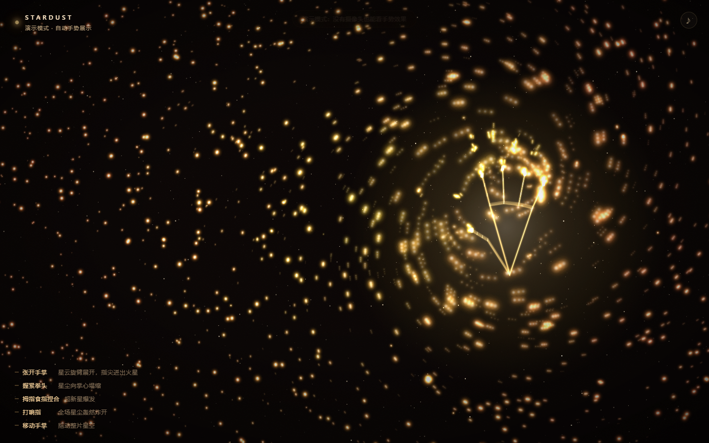
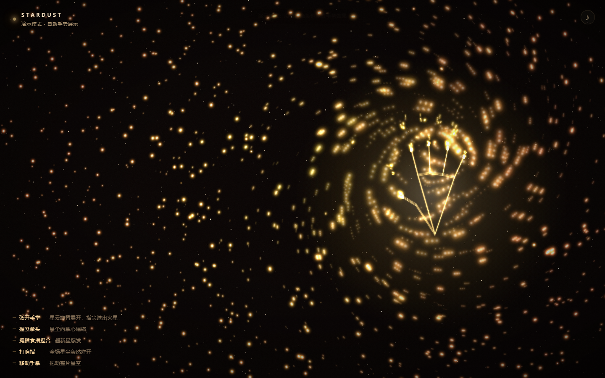
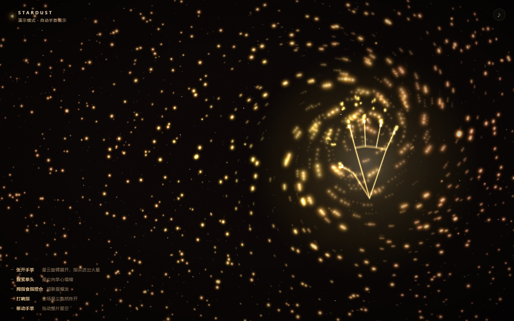

<div align="center">



# Stardust · 手

**把手伸进浏览器，让整片星空围着你的手指转。**

用摄像头识别你的手，21 个关键点实时变成引力场——
张开手掌，星云旋臂展开；握紧拳头，星尘塌缩成核；打个响指，整片星空轰然炸开。

<br/>


</div>

---

## 这是什么

一个**单文件**的实时交互作品：摄像头 → 手部骨架 → 粒子力场。

没有 Three.js，没有构建步骤，没有 `npm install`。
`index.html` 打开就是全部，所有物理、渲染、音效都是手写的。

<div align="center">
<table>
<tr>
<td width="50%"><br/><sub>张开手掌 · 旋臂展开，指尖迸出火星</sub></td>
<td width="50%"><br/><sub>握拳 · 星尘向掌心塌缩成核</sub></td>
</tr>
</table>

<sub>打响指 · 全场星尘向外轰开</sub>
</div>

---

## 手势

| 手势 | 效果 | 识别方式 |
|---|---|---|
| 🖐 **张开手掌** | 星云被撑开，旋臂绕手旋转，五指尖迸出火星 | 伸展手指数 |
| ✊ **握紧拳头** | 星尘向掌心塌缩成发光星核 | 伸展手指数 → 0 |
| 🤏 **拇指食指捏合** | 掌心局部超新星爆发 | 拇指尖-食指尖距离 |
| 🤞 **打响指** | 整片星空向外炸开 | 麦克风瞬态 + 视觉弹开 |
| 👋 **移动手掌** | 拖出光轨，带动整片星云 | 掌心位置平滑追踪 |
| 🙌 **双手** | 两个引力场同时作用 | 最多 2 只手 |

---

## 快速开始

> ⚠️ 浏览器规定：**摄像头和麦克风只在 `localhost` 或 HTTPS 下可用**。
> 直接双击 `index.html`（`file://`）会被拦截，必须起一个本地服务。

```bash
# 任选一种
python -m http.server 8931
npx serve .
```

然后打开 <http://127.0.0.1:8931/index.html>，点「开启星空」，允许摄像头。

**没有摄像头？** 加一个参数看自动演示：

```
http://127.0.0.1:8931/index.html?demo
```

---

## 技术实现

### 识别层

[MediaPipe Tasks Vision](https://github.com/google-ai-edge/mediapipe) 的 `HandLandmarker`，
`VIDEO` 模式、最多 2 只手、GPU 优先（失败自动回退 CPU）。
每帧只在视频帧更新时推理一次（约 30fps），渲染循环独立跑 60fps。

21 个关键点先做坐标映射（视频 → 屏幕，`cover` 裁剪补偿 + 水平镜像），
再经过指数平滑，手抖被吃掉，留下的是「有重量」的移动。

### 力场层

这是和常见「粒子跟随手的位置」最不一样的地方——**手不是一个坐标，是一个场**。

每只手对每个粒子施加四种力：

```js
径向力   F = strength / d²        // 握拳为正（吸引），张手为负（排斥）
切向力   S = swirl / d²           // 旋臂，张手时最强
短程斥力  push ∝ (120 - d)         // 防止粒子全部塌缩成一个点
指尖引力   每根指尖独立计算           // 张开时星尘绕着指尖流
```

`strength` 和 `swirl` 由「伸展手指数 / 5」实时插值：

```js
h.strength = 2.05 - 2.85 * spread;   // 握拳 2.05 / 张手 -0.80
h.swirl    = 0.05 + 1.05 * spread;   // 握拳 0.05 / 张手 1.10
```

阻尼也跟着手型走——握拳时更黏（快速塌缩），张手时更滑（旋臂流动）。
粒子还有个基于半径的差速旋转（中心快、外围慢），所以即使没有手，
它也会自己缓慢织出螺旋臂。

### 渲染层

Canvas 2D，加法混合（`lighter`）+ 半透明覆盖做拖尾。
每个粒子是一张预渲染的径向渐变精灵（52 档色相，按半径从金黄到橙红插值），
`drawImage` 缩放绘制，比逐帧建渐变快一个数量级。

粒子规模按屏幕面积自适应：约 **2200** 星云粒子 + **1200** 闪烁星点 + 最多 **560** 指尖火星。

### 声音层

全部用 Web Audio **实时合成**，仓库里没有任何音频文件：

- 底噪：三个振荡器（55 / 82.5 / 110.3 Hz）过低通 + 0.055Hz 的 LFO 呼吸
- 混响：程序生成的指数衰减脉冲响应，`ConvolverNode`
- 爆发音：正弦从 185Hz 扫到 32Hz + 低通噪声冲击
- 响指音：3.8k–7.2kHz 高通噪声（那声「啪」）+ 下坠轰鸣

### 响指识别

识别引擎看不到声音，所以响指用了两条独立的线：

1. **麦克风**（主）：`AnalyserNode` 分析 2.6k–7.2kHz 频段的瞬态能量，
   带自适应环境噪声基线，超过基线 6 倍即触发
2. **视觉**（兜底）：拇指与中指先贴近、0.15 秒内弹开，且中指伸直
   （用「中指伸直」排除「握拳后张开」的误判）

任一条触发都会调用 `snapBlast()`：所有粒子获得径向冲量，
速度上限临时从 13 放开到 57（`boost`），所以冲击真的打得出去。

---

## 项目结构

```
.
├── index.html              # 全部代码：HTML + CSS + JS（约 1200 行）
├── hand_landmarker.task    # MediaPipe 手部模型（7.5MB，Apache-2.0）
├── screenshots/            # 演示图
├── docs/tuning.md          # 代码地图 + 所有可调参数
├── LICENSE
└── README.md
```

---

## 调参 / 二次开发

想知道「粒子密度改哪行」「怎么加新手势」「怎么换配色」——
看 **[docs/tuning.md](docs/tuning.md)**，里面有完整的代码地图和参数表。

最常动的三个地方：

| 想要的效果 | 改哪里 |
|---|---|
| 粒子更密 | `initParticles()` 里的 `NEBULA` 上限 |
| 抓得更狠 | `h.strength = 2.05 - ...` 的 2.05 |
| 转得更疯 | `h.swirl = 0.05 + 1.05 * ...` 的 1.05 |

配色集中在文件顶部的 `THEME` 常量，换一套数值就是一个新星系。

---

## 已知限制

- **必须** localhost / HTTPS，否则摄像头不可用（浏览器安全策略，无法绕过）
- 首次运行需要联网下载 MediaPipe 的 WASM 运行时（约 3–6MB，之后有缓存）；
  模型文件已随仓库提供，不走网络
- 响指的音量阈值是经验值，安静环境下最准；环境嘈杂时可能漏检，
  但有视觉兜底
- 集显笔记本 + 2K 屏可能掉到 40fps 左右，可下调 `NEBULA`
- 只在 Chrome / Edge 上充分测试过；Safari 对 `getUserMedia` 和 AudioContext
  的时序更严格，可能需要点一下页面才有声音

---

## 隐私

所有识别、物理、声音分析都在**本地浏览器**里完成。
画面和音频不出设备，没有任何上传、没有后端。

---

## License

[MIT](LICENSE) © 2026 zly060115

手部识别由 [MediaPipe](https://github.com/google-ai-edge/mediapipe) 提供（Apache-2.0），
模型文件遵循其原始许可。

---

<div align="center"><sub>如果你也做了一个星系，欢迎 PR 或开 issue 聊聊。</sub></div>
