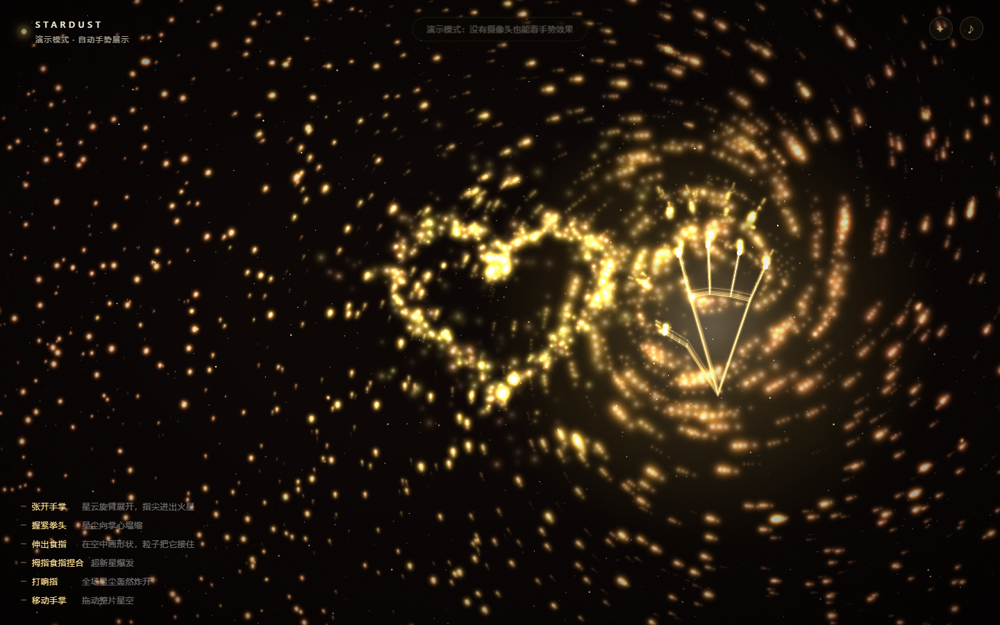
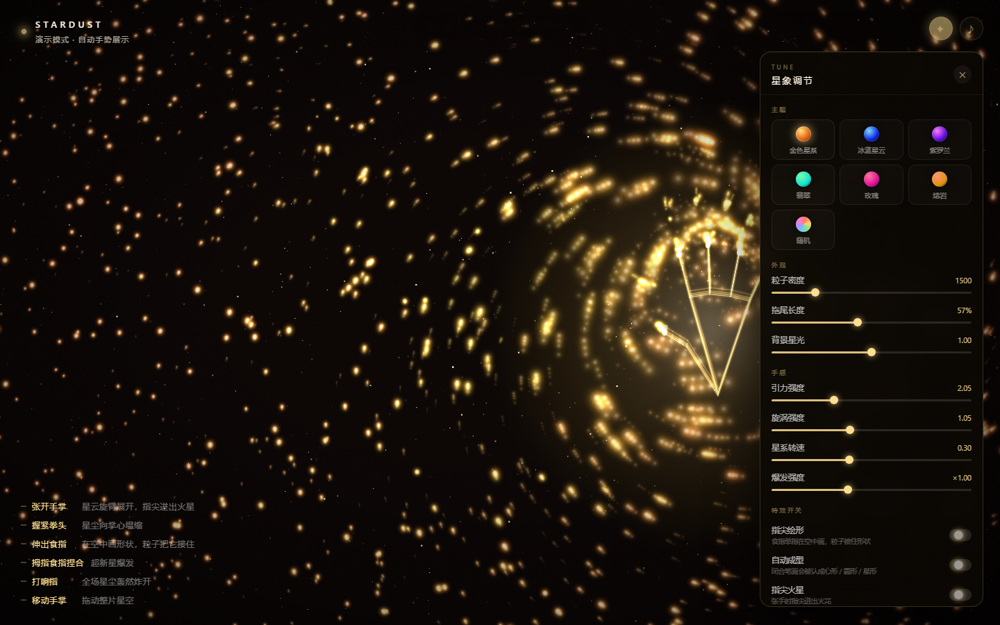

<div align="center">


# Stardust · 手

**把手伸进浏览器，让整片星空围着你的手指转。**

用摄像头识别你的手，21 个关键点实时变成引力场——
张开手掌，星云旋臂展开；握紧拳头，星尘塌缩成核；打个响指，整片星空轰然炸开。
**伸出食指在空中画，粒子会把你的笔迹接住**：画一颗心，它认得出，还你一颗规整的心；
写一个字，笔画原样留在星空里。

<br/>

<a href="https://zly060115.github.io/stardust-hand/"></a>

<br/><br/>


</div>

---

## 这是什么

一个**零依赖、零构建**的实时交互作品：摄像头 → 手部骨架 → 粒子力场。

没有 Three.js，没有打包器，没有 `npm install`。
代码按职责拆成 14 个 ES Module（识别、力场、粒子、绘形、音效各自独立），
浏览器原生加载，改完刷新就生效，所有物理、渲染、音效都是手写的。

配色、手感、密度、特效都能在**界面右上角的面板里实时调**，选择自动保存在本机。

<div align="center">
<table>
<tr>
<td width="50%"><br/><sub>张开手掌 · 旋臂展开，指尖迸出火星</sub></td>
<td width="50%"><br/><sub>握拳 · 星尘向掌心塌缩成核</sub></td>
</tr>
</table>

<sub>打响指 · 全场星尘向外轰开</sub>

<sub>食指在空中画一颗心 · 粒子飞过去把它接住</sub>

<sub>星象调节面板 · 六套主题 + 七项参数 + 特效开关，实时生效</sub>
</div>

---

## 手势

| 手势 | 效果 | 识别方式 |
|---|---|---|
| 🖐 **张开手掌** | 星云被撑开，旋臂绕手旋转，五指尖迸出火星 | 伸展手指数 |
| ✊ **握紧拳头** | 星尘向掌心塌缩成发光星核 | 伸展手指数 → 0 |
| ☝️ **食指单指** | **在空中画形状 / 写字**，粒子沿笔迹聚拢成形 | 食指伸出 + 其余三指收起 + 姿势稳定 0.2 秒 |
| 🤏 **拇指食指捏合** | 掌心局部超新星爆发 | 拇指尖-食指尖距离 |
| 🤞 **打响指** | 整片星空向外炸开 | 声音瞬态回落 + 拇指弹开时食指不动 |
| 👋 **移动手掌** | 拖出光轨，带动整片星云 | 掌心位置平滑追踪 |
| 🙌 **双手** | 两个引力场同时作用，各画各的 | 最多 2 只手 |

---

## 快速开始

> ⚠️ 浏览器规定：**摄像头和麦克风只在 `localhost` 或 HTTPS 下可用**。
> 直接双击 `index.html`（`file://`）会被拦截，必须起一个本地服务。

```bash
# 任选一种
python -m http.server 8931
npx serve .
```

然后打开 <http://127.0.0.1:8931/index.html>，点「开启星空」，允许摄像头。

**没有摄像头？** 加一个参数看自动演示：

```
http://127.0.0.1:8931/index.html?demo
```

---

## 技术实现

### 识别层

[MediaPipe Tasks Vision](https://github.com/google-ai-edge/mediapipe) 的 `HandLandmarker`，
`VIDEO` 模式、最多 2 只手、GPU 优先（失败自动回退 CPU）。
每帧只在视频帧更新时推理一次（约 30fps），渲染循环独立跑 60fps。

21 个关键点先做坐标映射（视频 → 屏幕，`cover` 裁剪补偿 + 水平镜像），
再经过指数平滑，手抖被吃掉，留下的是「有重量」的移动。

### 力场层

这是和常见「粒子跟随手的位置」最不一样的地方——**手不是一个坐标，是一个场**。

每只手对每个粒子施加四种力：

```js
径向力   F = strength / d²        // 握拳为正（吸引），张手为负（排斥）
切向力   S = swirl / d²           // 旋臂，张手时最强
短程斥力  push ∝ (120 - d)         // 防止粒子全部塌缩成一个点
指尖引力   每根指尖独立计算           // 张开时星尘绕着指尖流
```

`strength` 和 `swirl` 由「伸展手指数 / 5」实时插值：

```js
h.strength = 2.05 - 2.85 * spread;   // 握拳 2.05 / 张手 -0.80
h.swirl    = 0.05 + 1.05 * spread;   // 握拳 0.05 / 张手 1.10
```

阻尼也跟着手型走——握拳时更黏（快速塌缩），张手时更滑（旋臂流动）。
粒子还有个基于半径的差速旋转（中心快、外围慢），所以即使没有手，
它也会自己缓慢织出螺旋臂。

### 渲染层

Canvas 2D，加法混合（`lighter`）+ 半透明覆盖做拖尾。
每个粒子是一张预渲染的径向渐变精灵（72 档色相，按半径从核心色到外围色插值），
`drawImage` 缩放绘制，比逐帧建渐变快一个数量级。

粒子规模按屏幕面积自适应：约 **2200** 星云粒子 + **1200** 闪烁星点 + 最多 **560** 指尖火星，
面板里可以现场拖到 800–4200。

### 声音层

全部用 Web Audio **实时合成**，仓库里没有任何音频文件：

- 底噪：三个振荡器（55 / 82.5 / 110.3 Hz）过低通 + 0.055Hz 的 LFO 呼吸
- 混响：程序生成的指数衰减脉冲响应，`ConvolverNode`
- 爆发音：正弦从 185Hz 扫到 32Hz + 低通噪声冲击
- 响指音：3.8k–7.2kHz 高通噪声（那声「啪」）+ 下坠轰鸣

### 响指识别（以及它和写字的区分）

识别引擎看不到声音，所以响指用了两条独立的线：

1. **麦克风**（主）：`AnalyserNode` 分析 2.6k–7.2kHz 频段的能量，
   带自适应环境噪声基线。只判「超过基线 7 倍」还不够——说话、敲键盘都能过——
   所以还要**等它掉下来**：峰值后必须迅速衰减到 60% 以下才确认是瞬态，
   一直不衰减的当持续噪声丢掉（延迟约 2 帧）。
2. **视觉**（兜底）：拇指与中指先「贴合」（连续 ≥ 2 帧）再在 0.22 秒内弹开，
   而且弹开那一下**拇指在掌内的位移必须明显大于食指尖的位移**
   （写字是食指尖在扫、拇指跟着手走；响指正好相反）。

两条线都要求：手在画面里、当前没有在写字。

任一条触发都会调用 `snapBlast()`：所有粒子获得径向冲量，
速度上限临时从 13 放开到 57（`boost`），所以冲击真的打得出去。

**为什么要这么麻烦**：打响指和「食指单指写字」的静态姿势几乎一模一样
（都是食指伸出、其余收拢），只比几何距离必然互相误判。
所以除了上面两条判据，还加了一层**互斥锁**：

| 场景 | 行为 |
|---|---|
| 正在写一笔 | 不认响指（写到一半不会被「啪」一下打散） |
| 刚收笔 0.45 秒内 | 不认响指（抬手不是弹指） |
| 响指之后 0.5 秒内 | 不起笔（弹指那一下的食指抖动不会被记成一笔） |
| 拇指贴住中指（按压中） | 不落笔（这是按压，不是写字） |

判定逻辑单独在 `js/snap.js`（纯函数、无 DOM），
`node tools/test-snap.mjs` 跑回归：写字轨迹（含关键点抖动）零误判，真响指必中。

### 指尖绘形

伸出食指（其余三指收起）就进入画笔模式，食指尖的轨迹被抽稀记录下来：

```
起笔    姿势稳定 0.2 秒才算，稳定期那几帧的轨迹会在起笔时补回笔头
记录    指尖坐标 → 间距 > 7px 才采一个点，一笔最多 400 点
收笔    手放下或离开画面 0.18 秒后提交
识别    三道硬门槛都过才参与形状匹配（见下）
成形    沿目标曲线撒 380 个粒子，用弹簧把它们从笔迹位置拉过去
```

「稳定 0.2 秒才起笔」是为了不和响指的按压抢——按下弹开只有一两百毫秒，
来不及支起画笔；而写字时那 0.2 秒的轨迹不会丢，起笔时会补在笔头前面。

形状匹配是最朴素的做法，没有神经网络：
把用户笔迹和模板曲线都**归一化到单位框**，算双向平均最近距离，取误差最小且低于阈值的那个。
五个模板（心形 / 圆形 / 星形 / 三角 / 方形）各 64 个点，一次匹配不到 0.1ms。

**识别的第一原则是"宁可认不出，也不要把写的字改掉"**，所以模板比对之前有三道硬门槛，
任何一个不过就原样保留笔迹：

1. **首尾靠近**：收笔点要回到起笔点附近（首尾距 / 笔画长 < 0.20）
2. **围出面积**：笔画的有向面积要占包围盒 30% 以上 ——
   横、竖、来回折的连笔字面积趋近 0，天然被排除，而且这个指标对手抖几乎无感
3. **形状合理**：包围盒不扁平不细小；每个模板还有自己的前置条件
   （星形要有 4~6 个均匀分布的尖峰、圆的径向起伏要小、心形轮廓不许穿过质心……）

这些判据是踩过坑补上的：星形模板本身是"外-内-外"的往返折线，
和汉字笔画的折线在归一化空间里天然相似，不加门槛就会把写的字认成五角星。
完整的判定逻辑在 `js/shape.js`（纯几何、无 DOM），`node tools/test-shape.mjs`
可以跑回归测试：十几个汉字笔画必须原样保留，六个图形必须命中。

写一个字要好几笔，停笔 6 秒内的笔画会叠在同一张"纸"上，
一起淡出（20 秒），不会写到第三笔第一笔就没了。
认错了也不怕：面板里有「撤回一笔」，一次退掉刚刚写的那一笔。

关掉面板里的「自动成型」就是纯手写模式，画什么留什么。

---

## 项目结构

```
.
├── index.html              # 页面骨架（61 行）
├── css/
│   └── style.css           # 全部界面样式（CSS 变量驱动，跟着主题变色）
├── js/
│   ├── config.js           # 所有可调参数（手感 / 密度 / 绘形 / 阈值）
│   ├── settings.js         # 6 套主题预设 + 参数状态 + localStorage 记忆
│   ├── panel.js            # 右上角调节面板（滑块 / 开关 / 色板）
│   ├── state.js            # 运行时共享状态（live binding，避免循环依赖）
│   ├── render.js           # 光斑贴图缓存（72 档色相预渲染）
│   ├── viewport.js         # 画布尺寸
│   ├── particles.js        # 星云粒子：生成、力场物理、绘制
│   ├── hands.js            # 手势解析、骨架绘制、演示假手
│   ├── snap.js             # 响指判定：贴合→弹开 + 拇指/食指分工（纯逻辑，可独立测试）
│   ├── shape.js            # 闭合图形识别（纯几何，可独立测试）
│   ├── draw.js             # 指尖绘形：笔画 → 形状识别 → 粒子成形
│   ├── effects.js          # 爆发 / 响指冲击 / 指尖火星
│   ├── audio.js            # Web Audio 合成音效 + 麦克风瞬态检测
│   ├── engine.js           # MediaPipe 引擎加载 + 坐标映射
│   ├── ui.js               # DOM 引用与界面反馈
│   └── main.js             # 装配：主循环、启动流程、事件绑定
├── hand_landmarker.task    # MediaPipe 手部模型（7.5MB，Apache-2.0）
├── screenshots/            # 演示图
├── tools/test-shape.mjs    # 形状识别回归测试（node 直接跑）
├── tools/test-snap.mjs     # 响指 / 写字 误判回归测试（node 直接跑）
├── docs/tuning.md          # 模块地图 + 所有可调参数
├── LICENSE
└── README.md
```

模块依赖是无环的：`config → state → render/ui → particles/hands/draw → effects → main`。
手势层只产生事件标志（`evPinch` / `evSnap`…），由 `effects.consumeHandEvents()` 统一消费，
所以识别、音效、特效可以独立修改而互不影响。

参数流是单向的：面板 → `settings` → `applySettings()` → 写回 `config` 里各参数对象。
其它模块每帧从 config 读，所以改完当帧生效，不需要重启动画循环。

---

## 调参 / 二次开发

**日常微调不用改代码**：右上角 ✦ 面板里能换主题、调密度 / 拖尾 / 引力 / 旋涡 / 转速 / 爆发，
开关指尖火星与骨架，选择自动存在本机。六套预设之外还有「随机配色」。
底部「恢复默认」清掉记录回到出厂状态。

想改代码（加手势、加形状模板、加新粒子层）——
看 **[docs/tuning.md](docs/tuning.md)**，里面有完整的代码地图和参数表。

最常动的几个地方（都在 `js/config.js`）：

| 想要的效果 | 改哪里 |
|---|---|
| 粒子更密 | `SCALE.nebula.max`（现在 2600） |
| 抓得更狠 | `FIELD.pull`（现在 2.05） |
| 转得更疯 | `FIELD.swirlRange`（现在 1.05） |
| 笔画更细腻 | `DRAW.sampleDist`（现在 7px） |
| 只认标准的形状 | `DRAW.matchError` 调小 |

配色是 `settings.js` 里的 `THEMES` 数组，加一项就是一套新主题；
界面颜色全部走 CSS 变量，会自动跟着变。

---

## 已知限制

- **必须** localhost / HTTPS，否则摄像头不可用（浏览器安全策略，无法绕过）
- 首次运行需要联网下载 MediaPipe 的 WASM 运行时（约 3–6MB，之后有缓存）；
  模型文件已随仓库提供，不走网络
- 响指的音量阈值是经验值，安静环境下最准；环境嘈杂时可能漏检，
  但有视觉兜底
- 写完一笔后 0.45 秒内打响指不会生效（抬手动作和弹指太像，做了互斥）；
  同理落笔期间不认响指——想炸星空先把手抬起来
- 指尖绘形受摄像头视野限制：笔画画出画面会断；离镜头太近（<30cm）时关键点抖动大，
  建议 40–70cm，画的时候手腕别转太快
- 集显笔记本 + 2K 屏可能掉到 40fps 左右，可下调 `config.js` 里的 `SCALE.nebula.max`
- 只在 Chrome / Edge 上充分测试过；Safari 对 `getUserMedia` 和 AudioContext
  的时序更严格，可能需要点一下页面才有声音

---

## 隐私

所有识别、物理、声音分析都在**本地浏览器**里完成。
画面和音频不出设备，没有任何上传、没有后端。

---

## License

[MIT](LICENSE) © 2026 zly060115

手部识别由 [MediaPipe](https://github.com/google-ai-edge/mediapipe) 提供（Apache-2.0），
模型文件遵循其原始许可。

---

<div align="center"><sub>如果你也做了一个星系，欢迎 PR 或开 issue 聊聊。</sub></div>
